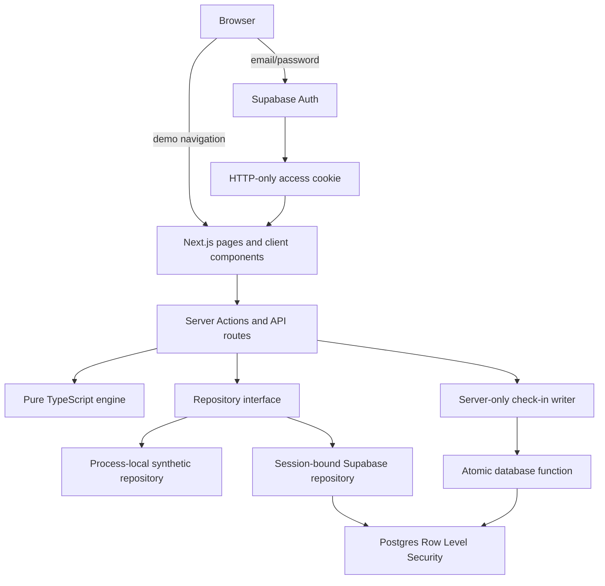

# Architecture

OncoNourish is a Next.js App Router application with a pure TypeScript
decision engine, server-side role checks, and repository implementations for
synthetic demo data or Supabase.

## Layers and data flow

- `src/engine/` contains typed rules for cycle phases, symptom filtering,
  recommendations, alerts, lapses, and progress. It does not import Next.js,
  Supabase, or a language model.
- `src/data/` contains the synthetic food library, placeholder thresholds,
  guardrail text, and fixed demo days.
- `src/app/` renders role-specific routes. Server Actions and API routes
  authenticate, authorize, validate inputs, then call repository/workflow
  functions. The browser does not choose an actor or patient identity for
  authorization.
- `src/lib/repository.ts` defines the data contract. `DemoRepository` is
  process-local and non-durable. `SupabaseRepository` uses the session token so
  Postgres RLS remains authoritative.
- The patient check-in write path computes deterministic signals, then uses a
  server-only database writer that rechecks ownership and stale history. It
  requires `SUPABASE_SERVICE_ROLE_KEY`; the key is never sent to the browser.
- Supabase profiles provision the application role. Sign-in reads the
  authenticated user's own profile and routes to `/patient`, `/caregiver`, or
  `/clinician`. A missing profile role does not create an app session.
- Caregiver reads are limited to check-ins for active links with current
  patient consent. The additional policy in migration
  `202611180003_caregiver_read_access.sql` is proposed but not applied to the
  linked hosted project.

## Modes and persistence

The demo has no real authentication. Demo state is shared only inside one
server process and resets on restart; it is not a security boundary or durable
storage. Supabase mode requires a provisioned Auth user and profile role.
Authenticated patient check-ins additionally require the reviewed database
migrations and server-only service key. The browser's optional check-in draft
uses localStorage per synthetic patient and cycle day; it is device-local and
is not an offline synchronization mechanism.

There is no model call in the current product. Patient questions are handled
by deterministic local guardrails and templates.
